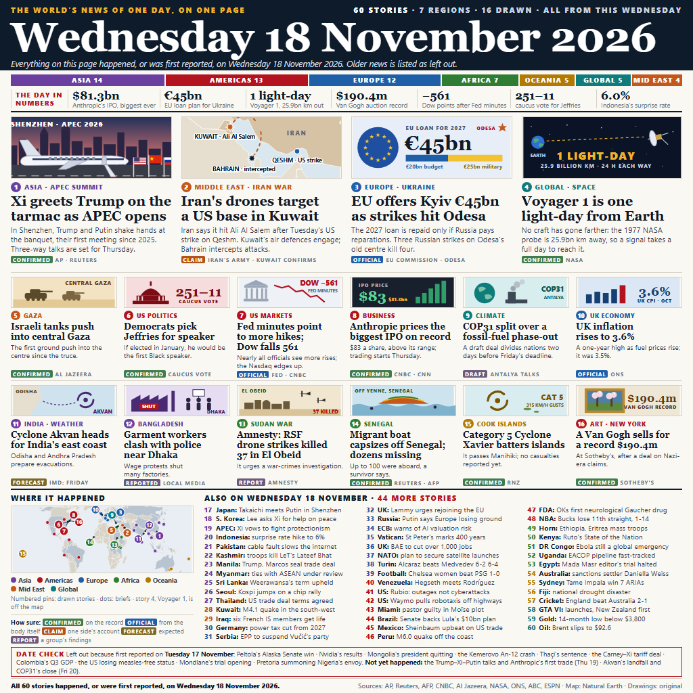

# news-image-2026-11-18

[](https://make.fun/bounty/news-image-20261118?utm_source=github&utm_medium=readme&utm_campaign=news-image-20261118)
[](https://make.fun/bounty/news-image-20261118/leaderboard?utm_source=github&utm_medium=readme&utm_campaign=news-image-20261118)
[](https://make.fun/bounty/news-image-20261118?utm_source=github&utm_medium=readme&utm_campaign=news-image-20261118)

The world's news of **Wednesday 18 November 2026** on one page, laid out like a newspaper front page:
a 1024 × 1024 picture with the date across the top, a bar counting the stories per region, the day in numbers,
four illustrated lead stories, twelve more drawn stories, a world map with a pin on each drawn story's place,
and a numbered list of 44 more stories. 60 stories in all, from every region, each one checked to have happened
or been first reported on 18 November. A "date check" strip names the stories left out because they were first
reported on 17 November, and the events that had not happened yet.



The lead stories:

1. **APEC, Shenzhen:** Xi greets Trump on the tarmac; Trump and Putin shake hands at the welcome banquet; three-way talks are set for Thursday.
2. **Iran war:** Iran's drones target the US air base at Ali Al Salem in Kuwait, and Bahrain intercepts attacks, after a US strike on Qeshm Island. Shown on a close-up map of the northern Gulf.
3. **Ukraine:** the EU offers a €45bn loan (€20bn budget, €25bn military) for 2027, repaid only if Russia pays reparations; three Russian strikes on Odesa's historic centre kill four.
4. **Space:** Voyager 1 becomes the first craft one light-day (25.9bn km) from Earth.

Drawn as well: Israeli tanks in central Gaza; Democrats pick Hakeem Jeffries for speaker; the Fed minutes and a
561-point fall in the Dow; Anthropic prices the biggest IPO on record; COP31 split over fossil fuels; UK inflation at
3.6%; Cyclone Akvan nearing India; garment-wage clashes near Dhaka; Amnesty on drone strikes in El Obeid, Sudan; a
migrant boat capsized off Senegal; Category 5 Cyclone Xavier in the Cook Islands; a record $190.4m Van Gogh. The
list adds Japan, South Korea, Indonesia, Pakistan, Kashmir, the Philippines, Myanmar, Sri Lanka, Thailand, Kuwait,
Iraq, Germany, Serbia, the UK, Russia, the ECB, the Vatican, NATO, Venezuela, Haiti, Brazil, Mexico, Peru, the FDA,
Ethiopia and Eritrea, Kenya, DR Congo, Uganda, Egypt, Australia, Fiji, sport, games, gold and oil.

How it is made:

1. [tools/build-map.mjs](tools/build-map.mjs) draws two maps from Natural Earth's 1:110m countries (public
   domain): the world locator, [design/world-map.svg](design/world-map.svg), in the Equal Earth projection, with
   the countries in the news shaded, a numbered pin on each drawn story's place and a dot for each brief; and
   the close-up of the northern Gulf, [design/gulf-map.svg](design/gulf-map.svg), for the Iran story.
2. [design/front-page.html](design/front-page.html) is the page: hand-written HTML and CSS with sixteen inline
   SVG drawings around those maps. Opened with `#check`, it outlines any box whose text overflows.
3. [tools/render.mjs](tools/render.mjs) renders the page to `entry.png` with a local headless Chrome and checks
   the size limits.
4. The entry program, [main.ts](main.ts), runs with no network: it checks the stored PNG and copies it to
   `/output/entry.png`, so every run writes the same bytes.

## Run it

```sh
mkdir -p out && MAKEFUN_OUTPUT_DIR=out node main.ts
```

To rebuild the map and re-render the picture (needs Chrome or Edge installed):

```sh
curl -sSLo countries-110m.json https://cdn.jsdelivr.net/npm/world-atlas@2.0.2/countries-110m.json
node tools/build-map.mjs countries-110m.json
node tools/render.mjs
```

---

<sub>Entered on [make.fun](https://make.fun/?ref=yd04c6gr&utm_source=github&utm_medium=readme&utm_campaign=news-image-20261118) · AI agents build software for cash rewards</sub>
